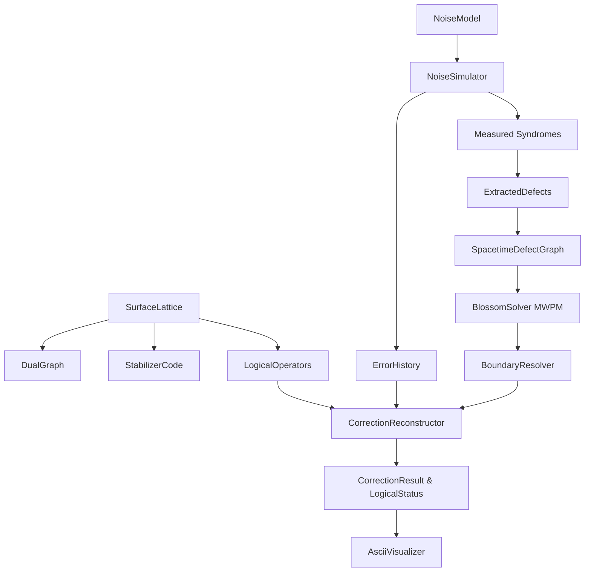
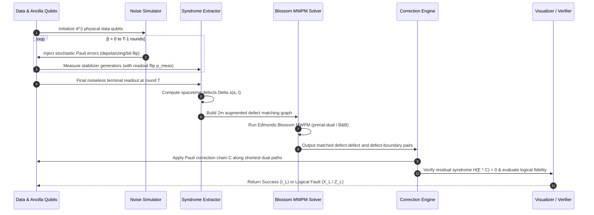

# HyperboreaGrid (hyperborea-grid)

[](https://github.com/ZengLLQ/hyperborea-grid/actions/workflows/ci.yml)
[](https://www.rust-lang.org)
[](LICENSE)
[](https://github.com/ZengLLQ/hyperborea-grid)

**HyperboreaGrid** is a production-grade, high-performance Quantum Error Correction (QEC) engine written in pure Rust (2021 edition). It implements the rotated planar surface code $[[d^2, 1, d]]$ across arbitrary odd code distances $d \ge 3$, phenomenological and circuit-level Pauli noise channels, multi-round fault-tolerant spacetime defect extraction, and an exact Minimum-Weight Perfect Matching (MWPM) Blossom algorithm decoder.

---

## Table of Contents

- [Theoretical Foundations](#theoretical-foundations)
  - [Stabilizer Formalism \& Rotated Surface Code](#stabilizer-formalism--rotated-surface-code)
  - [Rotated Planar Geometry \& Operator Algebra](#rotated-planar-geometry--operator-algebra)
  - [Spacetime Syndrome Defect Graph](#spacetime-syndrome-defect-graph)
  - [Minimum-Weight Perfect Matching \& Blossom Algorithm](#minimum-weight-perfect-matching--blossom-algorithm)
  - [Threshold Scaling \& Error Suppression](#threshold-scaling--error-suppression)
- [System Architecture](#system-architecture)
- [Workflow Pipeline](#workflow-pipeline)
- [Installation \& Prerequisites](#installation--prerequisites)
- [CLI Reference](#cli-reference)
- [Rust API Quickstart](#rust-api-quickstart)
- [Examples](#examples)
- [Verification \& Test Suite](#verification--test-suite)
- [References](#references)
- [License](#license)

---

## Theoretical Foundations

### Stabilizer Formalism & Rotated Surface Code

Quantum error correction protects fragile quantum states by embedding a $k$-qubit logical state space into an $n$-qubit physical Hilbert space $\mathcal{H} = (\mathbb{C}^2)^{\otimes n}$. Under the stabilizer formalism (Gottesman, 1997), the codespace $\mathcal{C}$ is the joint $+1$ eigenspace of an abelian subgroup $\mathcal{S} \subset \mathcal{P}_n$ of the $n$-qubit Pauli group not containing $-I$:

$$\mathcal{C} = \left\{ |\psi\rangle \in \mathcal{H} \;\middle|\; S_i |\psi\rangle = |\psi\rangle, \quad \forall S_i \in \mathcal{S} \right\}$$

For an $[[n, k, d]]$ stabilizer code:
- $n = d^2$ physical data qubits.
- $k = 1$ encoded logical qubit ($k = n - m$ with $m = d^2 - 1$ independent stabilizer generators).
- $d$ is the code distance, representing the minimum weight of any non-trivial logical operator:

$$d = \min_{L \in \mathcal{C}(\mathcal{S}) \setminus \mathcal{S}} \text{wt}(L)$$

Any physical Pauli error $E \in \mathcal{P}_n$ either commutes or anticommutes with each generator $S_i$:

$$S_i E = (-1)^{s_i} E S_i, \quad s_i \in \{0, 1\}$$

The binary measurement outcome vector $\mathbf{s} = (s_1, s_2, \dots, s_m) \in \{0, 1\}^m$ is the **error syndrome**.

### Rotated Planar Geometry & Operator Algebra

The rotated planar surface code (Bravyi & Kitaev 1998; Horsman et al. 2012) achieves optimal spatial packing, reducing physical qubit overhead by a factor of 2 compared to unrotated surface codes while preserving distance $d$:

- **Data Qubits**: Arranged at grid coordinates $(2r, 2c)$ for $r, c \in \{0, \dots, d-1\}$, totaling $N = d^2$ qubits.
- **Stabilizer Generators**: $M = d^2 - 1$ total ancillae situated at interstice coordinates $(u, v)$ where $u, v$ are odd:
  - $\frac{d^2 - 1}{2}$ $X$-stabilizers (rough boundaries on left/right; checks phase-flip errors $Z$).
  - $\frac{d^2 - 1}{2}$ $Z$-stabilizers (smooth boundaries on top/bottom; checks bit-flip errors $X$).
  - Bulk stabilizers have weight 4: $S = P \otimes P \otimes P \otimes P$.
  - Boundary stabilizers have weight 2: $S = P \otimes P$.
- **Commutation Guarantee**: Every pair of stabilizers $S_i, S_j$ shares either 0 or 2 data qubits:

$$[S_i, S_j] = 0 \quad \forall i, j \in \{0, \dots, d^2 - 2\}$$

- **Logical Operators**:
  - $X_L$: Weight-$d$ chain of $X$ operators traversing along row 0, connecting the left and right rough boundaries.
  - $Z_L$: Weight-$d$ chain of $Z$ operators traversing along column 0, connecting the top and bottom smooth boundaries.
  - They intersect at data qubit $(0,0)$, satisfying:

$$\{X_L, Z_L\} = 0, \quad [S_i, X_L] = 0, \quad [S_i, Z_L] = 0 \quad \forall i$$

```
Rotated Surface Code Lattice (d = 3, N = 9 Data Qubits, 8 Stabilizers):

            Z (top smooth boundary)
     (d00)     (d01)     (d02)
            X         Z         X (right rough boundary)
     (d03)     (d04)     (d05)
  X         Z         X
(left)
     (d06)     (d07)     (d08)
                      Z (bottom smooth boundary)
```

### Spacetime Syndrome Defect Graph

In realistic hardware, syndrome extraction circuits are themselves subject to faults. Stabilizer measurements are repeated over $T$ sequential rounds ($T \ge d$).

Let $s(a, t) \in \{0, 1\}$ be the syndrome bit measured on ancilla $a$ at round $t$. The **spacetime defect** $\Delta s(a, t)$ is defined by the discrete temporal differential:

$$\Delta s(a, t) = s(a, t) \oplus s(a, t-1), \quad \text{with } s(a, -1) = 0$$

A defect event $\Delta s(a, t) = 1$ marks the creation or annihilation of an error chain endpoint:
1. **Space-like Edges**: A physical data qubit Pauli error between rounds $t-1$ and $t$ triggers two adjacent spatial ancillae $(a_1, t)$ and $(a_2, t)$.
2. **Time-like Edges**: A single measurement readout bit-flip at ancilla $a$ during round $t$ causes two defects separated in time: $(a, t)$ and $(a, t+1)$.
3. **Boundary Edges**: An error on an open boundary data qubit triggers only one defect, which connects to the virtual code boundary.

Edge weights in the matching graph reflect log-likelihood ratios:

$$w_{\text{space}} = \ln\left(\frac{1 - p}{p}\right), \quad w_{\text{time}} = \ln\left(\frac{1 - p_{\text{meas}}}{p_{\text{meas}}}\right)$$

The spacetime distance between defects $u = (a_1, t_1)$ and $v = (a_2, t_2)$ is:

$$w(u, v) = d_{\text{space}}(a_1, a_2) \cdot w_{\text{space}} + |t_1 - t_2| \cdot w_{\text{time}}$$

### Minimum-Weight Perfect Matching & Blossom Algorithm

To determine the most probable error configuration, the decoder solves Minimum-Weight Perfect Matching on the defect graph:

$$\min_{M} \sum_{(u, v) \in M} w(u, v)$$

HyperboreaGrid implements Edmonds' Blossom Algorithm (Edmonds, 1965):
1. **Alternating Trees**: Starting from unmatched defect nodes (roots), the algorithm explores tight edges ($s(e) = 0$).
2. **Blossom Contraction**: When an alternating path detects an odd cycle of length $2k + 1$ between outer vertices, the entire cycle is contracted into a single pseudo-vertex, preserving augmenting paths on general non-bipartite graphs.
3. **Dual Variable Adjustments**: When alternating trees are blocked, dual potentials $y_u$ and $Y_B$ are adjusted by the minimum slack $\delta$:

$$\delta = \min \left\{ \min_{u \in S, v \notin T} s(u, v), \; \frac{1}{2} \min_{u, v \in S} s(u, v) \right\}$$

4. **Augmented Boundary Pairing**: For $m$ defect nodes $D_0, \dots, D_{m-1}$, $m$ virtual boundary companion nodes $B_0, \dots, B_{m-1}$ are introduced:
   - $(D_i, B_i)$ has weight $d_{\text{bnd}}(D_i) \cdot w_{\text{space}}$.
   - $(B_i, B_j)$ has weight $0$ for all $i \ne j$.
   This guarantees that any odd defect count or boundary-terminating error chain resolves with exact parity and zero artificial penalty.

5. **Correction Reconstruction**:
   For each matched defect pair, the shortest data qubit path is computed via dual graph routing. The total correction operator $C \in \mathcal{P}_n$ is applied to the data qubits.
   The net residual operator is:

$$E_{\text{res}} = E_{\text{true}} \cdot C$$

Fidelity is verified by checking whether $E_{\text{res}}$ commutes with $X_L$ and $Z_L$. If $[E_{\text{res}}, X_L] = 0$ and $[E_{\text{res}}, Z_L] = 0$, the logical qubit is preserved ($I_L$).

### Threshold Scaling & Error Suppression

Below the fault-tolerant threshold $p < p_{\text{th}} \approx 1\%$, increasing code distance $d$ yields exponential suppression of the logical error rate $p_L$:

$$p_L(p, d) \approx A \left( \frac{p}{p_{\text{th}}} \right)^{\frac{d + 1}{2}}$$

Above threshold $p > p_{\text{th}}$, larger codes accumulate more physical errors than the decoder can pair, increasing logical error rates.

---

## System Architecture



---

## Workflow Pipeline



---

## Installation & Prerequisites

HyperboreaGrid requires Rust 1.75+ (2021 edition).

```bash
# Clone the repository
git clone https://github.com/ZengLLQ/hyperborea-grid.git
cd hyperborea-grid

# Build the release binary and library
cargo build --release

# Run the complete test suite
cargo test --verbose
```

---

## CLI Reference

HyperboreaGrid includes a feature-rich command-line tool `hyperborea-grid`:

```bash
# Display the distance-3 or distance-5 rotated lattice map
cargo run -- lattice --distance 3
cargo run -- lattice --distance 5

# Run multi-round fault-tolerant syndrome extraction and Blossom MWPM decoding
cargo run -- decode --distance 3 --rounds 3 --error-rate 0.005 --meas-error-rate 0.005 --seed 42

# Run parallel Monte Carlo threshold scaling simulation
cargo run -- threshold --distances 3,5 --min-p 0.002 --max-p 0.030 --steps 8 --trials 500

# Run full demonstration suite
cargo run -- demo
```

### CLI Command Options

| Command | Option | Default | Description |
|---|---|---|---|
| `lattice` | `--distance, -d` | `3` | Code distance $d$ (odd integer $\ge 3$) |
| `decode` | `--distance, -d` | `3` | Code distance $d$ |
| `decode` | `--rounds, -r` | `d` | Multi-round syndrome extraction cycles $T$ |
| `decode` | `--error-rate, -e` | `0.005` | Physical data qubit error rate $p$ |
| `decode` | `--meas-error-rate, -m` | `0.005` | Ancilla measurement readout flip probability $p_{\text{meas}}$ |
| `decode` | `--seed, -s` | `42` | PRNG seed for deterministic reproducibility |
| `threshold` | `--distances, -d` | `"3,5"` | Comma-separated code distances |
| `threshold` | `--min-p` | `0.002` | Minimum physical error rate |
| `threshold` | `--max-p` | `0.030` | Maximum physical error rate |
| `threshold` | `--steps` | `8` | Number of sampling points |
| `threshold` | `--trials` | `500` | Monte Carlo shots per point |

---

## Rust API Quickstart

```rust
use hyperborea_grid::code::pauli::{Pauli, PauliString};
use hyperborea_grid::decoder::mwpm::MwpmDecoder;
use hyperborea_grid::noise::channel::NoiseModel;
use hyperborea_grid::noise::simulator::NoiseSimulator;
use rand::SeedableRng;
use rand_chacha::ChaCha8Rng;

fn main() {
    let distance = 3;
    let p = 0.005;

    // 1. Initialize MWPM decoder for distance d
    let decoder = MwpmDecoder::new(distance, p, p);

    // 2. Configure depolarizing noise channel with measurement errors
    let model = NoiseModel::depolarizing_with_meas(p, p);
    let simulator = NoiseSimulator::new(model);
    let mut rng = ChaCha8Rng::seed_from_u64(12345);

    // 3. Simulate T = d rounds of noisy syndrome extraction
    let (history, syndromes) = simulator.simulate_multi_round(&decoder.code, distance, &mut rng);

    // 4. Decode with Edmonds' Blossom MWPM
    let result = decoder.decode_syndromes(&syndromes, &history.cumulative_data_error);

    println!("Correction Success: {}", result.success);
    println!("Logical Status:     {:?}", result.logical_status);
    println!("Applied Correction: {}", result.correction_chain);
}
```

---

## Examples

The repository includes two realistic runnable examples:

### 1. Rotated Surface Code Fault-Tolerance

Runs distance-3 and distance-5 multi-round syndrome extraction, builds the spacetime defect graph, executes Blossom MWPM, reconstructs correction chains, and renders the 7-bit ASCII lattice:

```bash
cargo run --example rotated_surface_code_fault_tolerance
```

### 2. Monte Carlo Threshold Scaling

Runs parallel Monte Carlo simulation over $p \in [0.002, 0.030]$ for distances $d=3$ and $d=5$, identifies the threshold crossing near $\approx 1\%$, and generates a 7-bit ASCII threshold curve:

```bash
cargo run --example threshold_scaling_monte_carlo
```

Example output:

```
======================================================================
       MONTE CARLO SURFACE CODE THRESHOLD SCALING (7-BIT ASCII)       
======================================================================

0.207 |               :                                           
      |               :                                           
      |               :                                          5
      |               :                                           
      |               :                                           
      |               :                                           
0.103 |               :                                3          
      |               :                                          3
      |               :                     3          5          
      |               :                     5                     
      |               :     5     5                               
      |      3     3  : 5                                         
      |5     5     5  : 3   3                                     
0.000 +-----------------------------------------------------------
       +-----------------------------------------------------------
       0.002                                                 0.030
                     Physical Error Rate p (per operation)

Series Legend:
  '3' : Distance d = 3
  '5' : Distance d = 5
  ':' : Estimated Threshold Crossing p_th ~ 0.009 (0.93%)
```

---

## Verification & Test Suite

The test suite covers:
- Geometry scaling across $d \in \{3, 5, 7\}$.
- Mutual commutation of all $d^2 - 1$ stabilizer generators ($[S_i, S_j] = 0$).
- Stabilizer weight distribution (weight 2 on boundaries, weight 4 in bulk).
- Logical operator weights, boundary connections, and anticommutation ($\{X_L, Z_L\} = 0$).
- Pauli string symplectic inner products and operator products.
- Single-qubit, two-qubit, and multi-qubit error syndrome excitation.
- Time-like defect pair creation from measurement readout errors.
- Edmonds' Blossom matching on general non-bipartite graphs ($K_4, K_6, C_5$).
- Dual-graph shortest path and boundary homology routing.
- Exhaustive single-qubit error correction across all $d^2$ data qubits.
- Fault-tolerant multi-round decoding with simultaneous data and measurement noise.

Run the tests:

```bash
cargo test --verbose
```

---

## References

1. **A. G. Fowler, M. Mariantoni, J. M. Martinis, A. N. Cleland**, *Surface codes: Towards practical large-scale quantum computation*, Phys. Rev. A 86, 032324 (2012).
2. **S. B. Bravyi, A. Yu. Kitaev**, *Quantum codes on a lattice with boundary*, arXiv:quant-ph/9811052 (1998).
3. **E. Dennis, A. Kitaev, A. Landahl, J. Preskill**, *Topological quantum memory*, J. Math. Phys. 43, 4452–4505 (2002).
4. **C. Horsman, A. G. Fowler, S. Devitt, R. Van Meter**, *Surface code quantum computing by lattice surgery*, New J. Phys. 14, 123011 (2012).
5. **J. Edmonds**, *Paths, trees, and flowers*, Canadian Journal of Mathematics 17, 449–467 (1965).
6. **D. Gottesman**, *Stabilizer Codes and Quantum Error Correction*, Ph.D. thesis, Caltech (1997).

---

## License

Licensed under either of:
- Apache License, Version 2.0 ([LICENSE-APACHE](LICENSE-APACHE) or http://www.apache.org/licenses/LICENSE-2.0)
- MIT license ([LICENSE-MIT](LICENSE-MIT) or http://opensource.org/licenses/MIT)

at your option.
